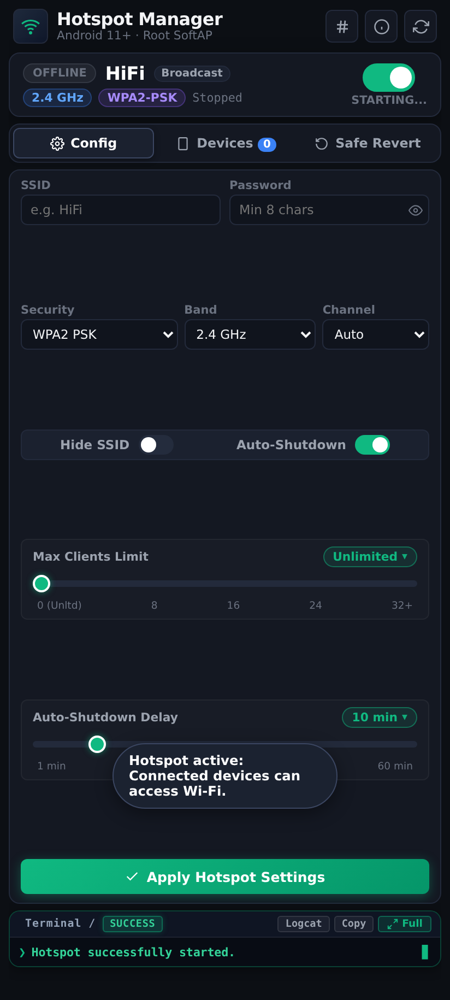
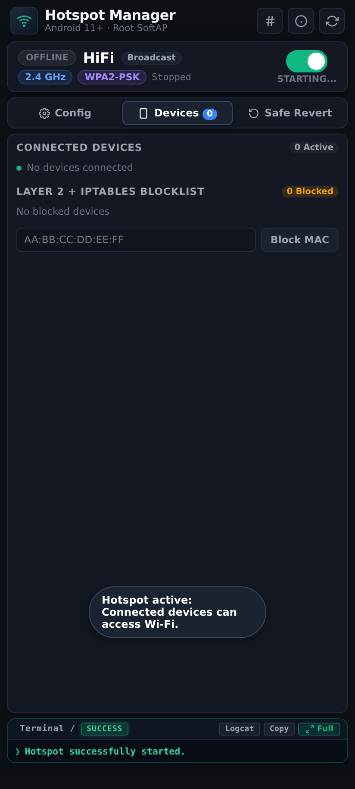
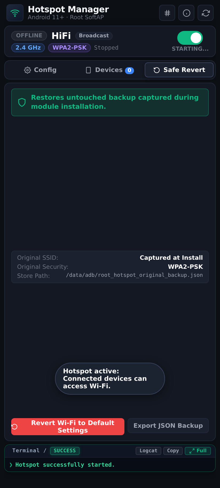
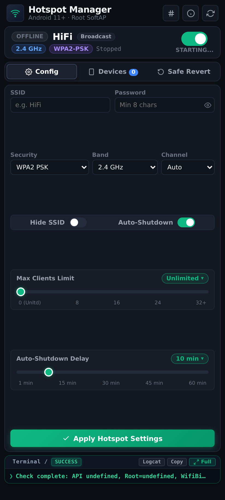

# HMR (Root Hotspot Manager)

[](https://github.com/uniqueselect/HMR/releases)
[-brightgreen?style=flat-square)](https://developer.android.com/about/versions/11)
[](https://github.com/topjohnwu/Magisk)
[-purple?style=flat-square)](https://github.com/uniqueselect/HMR)
[](https://github.com/5ec1cff/KsuWebUIStandalone)

A modular, root-powered Wi-Fi SoftAP controller with a modern standalone WebUI dashboard, engineered specifically for **Android 11+ (API 30+)** across AOSP, Project Treble GSIs, and OEM vendor implementations (MediaTek, Qualcomm, Samsung Exynos, Unisoc).

Developed and maintained by **[uniqueselect](https://github.com/uniqueselect)** & **Anti-Gravity**.

---

> [!WARNING]
> ### ⚠️ EXPERIMENTAL TESTING NOTICE & DISCLAIMER OF LIABILITY
> **HMR is currently in active development and experimental testing.** This utility interacts directly with low-level Android Binder IPC frameworks (`IWifiManager`), network routing tables, and Linux kernel firewall hooks (`iptables`). It is intended exclusively for developers, power users, and Android root enthusiasts.
>
> **DISCLAIMER**: Under no circumstances shall the authors, contributors, or maintainers be held liable for any damages whatsoever—including but not limited to hard bricks, bootloops, partition corruption, data loss, network anomalies, carrier throttling, or hardware malfunctions. **Flash and execute at your own risk. Always maintain an off-device Nandroid or full system backup before proceeding.**

---

## 📱 Screenshots & WebUI Tour

The HMR user interface adheres to the modern KernelSU WebUI specification, styled with an adaptive dark theme and optimized for mobile screens.

| 01. Master Configuration | 02. Connected Devices Monitor | 03. Safe Revert Engine |
| :---: | :---: | :---: |
|  |  |  |
| **Hotspot Toggle, SSID, Band, Channel & Sliders** | **Real-Time Client Discovery & MAC/L3 Blocking** | **Factory Backup Inspection & Safe Revert** |

| 04. System Diagnostics Engine | 05. Dev Lab & About |
| :---: | :---: |
|  |  |
| **Root, Binder IPC & MediaTek/QCOM Checks** | **Engine Specs, Versions & Crypto Donation Info** |

---

## 🌟 Architectural Overview

Traditional hotspot manipulation modules often attempt to parse and modify raw XML files (such as `/data/misc/wifi/WifiConfigStore.xml`). This approach is brittle across Android revisions, causes XML corruption bootloops, and requires a full system reboot to take effect.

**HMR adopts an official, dynamic IPC architecture:**

```
┌────────────────────────────────────────────────────────┐
│                   HMR WebUI / CLI                      │
│    (KSUWebUIStandalone / MMRL / Termux hotspot-ctl)    │
└──────────────────────────┬─────────────────────────────┘
                           │ executes via app_process
┌──────────────────────────▼─────────────────────────────┐
│          bin/hotspot_helper.jar (DEX)                  │
│  - Bypasses raw XML tampering completely               │
│  - Acquires android.net.wifi.IWifiManager Binder       │
│  - Dispatches SoftApConfiguration.Builder calls        │
│  - Real-time ARP & hostapd event parsing               │
└──────────────────────────┬─────────────────────────────┘
                           │ Native IPC
┌──────────────────────────▼─────────────────────────────┐
│          Android Framework (system_server)             │
│        Wi-Fi HAL & hostapd / wificond daemons          │
└────────────────────────────────────────────────────────┘
```

1. **Zero Raw XML Tampering**:
   - Configuration is manipulated at runtime via Android 11's official `android.net.wifi.SoftApConfiguration` API using reflection on hidden system methods.
2. **Runtime Settings Hot-Reloading (No Reboots for Hotspot Changes)**:
   - Configuration adjustments (SSID, password, band, stealth hidden mode, client caps) take effect dynamically at runtime via live Android framework Binder calls. SoftAP updates seamlessly without rebooting Android.
   - *(Note: Initial module installation or updating still requires a standard device reboot so Magisk/KernelSU can finalize filesystem mounts).*
3. **Guaranteed Settings Reversibility**:
   - **Pre-flight Snapshot**: Upon initial flash, `customize.sh` captures your untouched stock Wi-Fi hotspot configuration to `/data/adb/root_hotspot_original_backup.json`.
   - **One-Click Safe Revert**: Revert to the stock factory configuration at any time from the WebUI.
   - **Uninstall Protection**: When the module is removed via Magisk/KSU, `uninstall.sh` automatically restores the captured original configuration before removing module files.
4. **Zero Persistent Daemons / Zero Battery Drain**:
   - No background polling daemons or file watchers. Queries run on-demand synchronously when requested by the UI or CLI.
5. **Universal Hardware Compatibility**:
   - Seamlessly handles vendor quirks across MediaTek MT6769V (Helio G80) proprietary SoftAP drivers, Qualcomm Snapdragon WLAN HALs, Samsung Exynos, and Generic System Images (GSI).

---

## ⚡ Core Features

- 📶 **Master Control**: Single-tap toggle for instant SoftAP activation and deactivation.
- 🏷️ **SSID & Security Suite**: Configure SSID, WPA2-PSK, WPA3-SAE, WPA3-Transition, or Open networks with instant password reveal.
- 📡 **Dual-Band & Channel Optimization**: Seamlessly switch between 2.4 GHz (Long Range) and 5.0 GHz (High Throughput), with manual 802.11 channel selection (Ch 1–11 for 2.4GHz; Ch 36–165 for 5GHz).
- 👻 **Stealth Mode (Hidden SSID)**: Toggle broadcast beaconing on or off to make the hotspot invisible to passive network scanners.
- 👥 **Dynamic Client Limiting**: Numeric stepper slider to constrain maximum concurrent connections (1 to 32 clients, or Unlimited).
- ⏱️ **Intelligent Inactivity Timeout**: Auto-shutdown timer (custom presets: 5m, 10m, 15m, 30m, 60m, or disabled) that automatically turns off the hotspot when all devices disconnect.
- 🔍 **Real-Time 802.11 Client Discovery**:
  - Universal ARP/NDP discovery via `/proc/net/arp` and `ip neigh show`.
  - Dynamic disconnect tracking: automatically reduces device count and clears disconnected clients without false positives.
  - Active vendor/device hostname resolution from DHCP leases (`/data/misc/dhcp/dnsmasq.leases`).
- 🛡️ **Dual-Layer Client Blocking**:
  - **Layer 2 (Data Link)**: Blocks MAC addresses at the SoftAP driver level (`hostapd_cli block_mac`).
  - **Layer 3/4 (Network)**: Drops client traffic via kernel packet filtering (`iptables -I FORWARD -m mac --mac-source <MAC> -j DROP`).
- 🩺 **Integrated Diagnostic Suite**: Self-testing modal that probes root capabilities, Binder IPC connectivity, Android 11 API level, and vendor Wi-Fi interface bindings.

---

## 📦 Directory Structure

```text
HMR/
├── module.prop                 # Module identity, versioning, and description
├── customize.sh               # Installation pre-flight check & factory backup
├── uninstall.sh               # Automatic stock Wi-Fi restoration upon removal
├── service.sh                 # Boot-time persistence for firewall rules
├── action.sh                  # Magisk Action button launcher for KSUWebUIStandalone
├── bin/
│   ├── hotspot-ctl            # Multi-call CLI shell interface
│   ├── hotspotctl             # Symlink helper
│   └── hotspot_helper.jar     # Compiled Android DEX root helper (Java)
├── src/                       # Java source code for the DEX root helper
│   └── com/antigravity/hotspot/
│       └── HotspotHelper.java # Binder reflection, client monitoring & AIDL control
├── docs/                      # Documentation assets & screenshots
│   └── screenshots/
│       ├── 01_dashboard_config.png
│       ├── 02_devices_monitor.png
│       ├── 03_safe_revert.png
│       ├── 04_diagnostics_modal.png
│       └── 05_dev_lab_modal.png
└── webroot/                   # Modern responsive WebUI dashboard
    ├── index.html             # HTML5 structure with SVG icons & tab navigation
    ├── style.css              # Cyber-slate dark theme styling
    └── app.js                 # Bridge controller & mock preview provider
```

---

## 🚀 Installation & Getting Started

HMR provides two flexible deployment options:

### Option A: Standalone Root APK (Recommended — No Reboot Needed!)
1. Download **`HMR-v1.2.4.apk`** from [Releases](https://github.com/uniqueselect/HMR/releases).
2. Install the APK normally on your Android device.
3. Open **Hotspot Manager** from your home screen / app launcher.
4. Grant Superuser root access when prompted by Magisk, KernelSU, or APatch.
5. **Ready immediately! Zero reboots required.**

---

### Option B: Magisk / KernelSU / APatch Module (WebUI Standard)
1. Download the flashable module ZIP package from [Releases](https://github.com/uniqueselect/HMR/releases).
2. Open **Magisk Manager**, **KernelSU**, or **APatch**.
3. Navigate to **Modules** -> **Install from storage** and flash the ZIP.
4. Reboot your device to activate the Magisk filesystem mount.
5. Launch the WebUI via **KSUWebUIStandalone** (`io.github.a13e300.ksuwebui`), **MMRL**, or tap the **Action** button next to HMR in Magisk.

---

## 💻 CLI Usage (`hotspot-ctl`)

HMR includes a command-line interface accessible via Termux or any root ADB shell:

```bash
# Check hotspot status and active configuration (JSON)
su -c hotspot-ctl status

# List currently connected clients (IP, MAC, Hostname, Interface)
su -c hotspot-ctl clients

# Start the Wi-Fi hotspot
su -c hotspot-ctl start

# Stop the Wi-Fi hotspot
su -c hotspot-ctl stop

# Restore factory stock Wi-Fi settings
su -c hotspot-ctl restore-original

# Run hardware and API diagnostic checks
su -c hotspot-ctl check

# View real-time SoftAP logs from wificond & hostapd
su -c hotspot-ctl logcat
```

---

## ❓ Frequently Asked Questions (FAQ)

### Q1: Why do I need to reboot after flashing/updating, but NOT when modifying hotspot settings?
- **Module Flash / Update (Device Reboot Required)**:
  When you install or update a module in Magisk, Magisk extracts files to `/data/adb/modules_update/<module_id>/` rather than the active directory. Magisk's boot daemon (`magiskinit`) only moves files from `modules_update` to `/data/adb/modules/<module_id>/` during early boot (`post-fs-data`). WebUI standalone hosts (such as **KSUWebUIStandalone** or **MMRL**) strictly search `/data/adb/modules/<module_id>/webroot/`. Until you reboot, the WebUI files either do not exist or remain on the previous version.
- **Wi-Fi Hotspot Configuration (Zero Reboots Needed)**:
  Unlike legacy root tweaks that overwrite `/data/misc/wifi/WifiConfigStore.xml` on disk (which requires an Android reboot to reload into memory), HMR communicates directly with Android's active `system_server` process via Binder IPC (`IWifiManager`). Changes to SSID, password, band, channel, stealth hidden mode, or client limits are accepted dynamically by Android's running Wi-Fi framework and apply immediately without rebooting.

### Q2: Why did we build our own DEX root helper (`hotspot_helper.jar`)?
Android 11 tightened access to `WifiManager.setSoftApConfiguration()` by marking it `@hide` and `@SystemApi`. Standard shell commands like `cmd wifi` do not expose parameters for hidden SSIDs, band switching, or client caps. `hotspot_helper.jar` runs inside `app_process` with root UID (0) and uses reflection to access the official `SoftApConfiguration.Builder` API directly.

### Q3: How does disconnect detection work on MediaTek, Qualcomm, and OEM devices?
On stock OEM ROMs and Project Treble GSIs (where vendor-proprietary Wi-Fi chipsets often lack `iw dev station dump` support), HMR uses an intelligent dual-source pipeline:
1. Reads `/proc/net/arp` and `ip neigh show` for active IP-to-MAC mappings.
2. Filters out stale entries (`FAILED`, `INCOMPLETE`, `00:00:00:00:00:00`).
3. Evaluates `hostapd: AP-STA-DISCONNECTED` logcat events to immediately purge disconnected clients and decrement active device counters.

### Q4: Does HMR contain any hardcoded IP addresses, ports, or device fingerprints?
**Zero.** HMR is strictly universal. The hotspot gateway IP is dynamically resolved using:
```bash
ip route show table local proto kernel scope host | grep -E 'ap0|wlan'
```
There are no hardcoded IP addresses, vendor backdoors, or device-specific traces.

### Q5: What happens if I uninstall the module?
During uninstallation, Magisk or KernelSU executes `uninstall.sh`. This script automatically reads your pre-installation snapshot (`/data/adb/root_hotspot_original_backup.json`) and invokes `hotspot_helper.jar restore` to safely restore your device's stock Wi-Fi configuration before cleaning up module files.

### Q6: How do I build the DEX helper from source?
You can recompile `HotspotHelper.java` using any standard Android SDK (API 30+):
```bash
# Compile Java source
javac -cp "$ANDROID_HOME/platforms/android-30/android.jar" -d /tmp/classes src/com/antigravity/hotspot/HotspotHelper.java

# Convert class files to DEX
d8 --output /tmp/dex /tmp/classes/com/antigravity/hotspot/*.class

# Package into JAR
cd /tmp/dex && zip -j hotspot_helper.jar classes.dex
```

---

## 📜 License & Credits

- **Authors**: [uniqueselect](https://github.com/uniqueselect) & **Anti-Gravity**
- **Repository**: [https://github.com/uniqueselect/HMR](https://github.com/uniqueselect/HMR)
- **License**: MIT License - Free for community enhancement, testing, and distribution.
