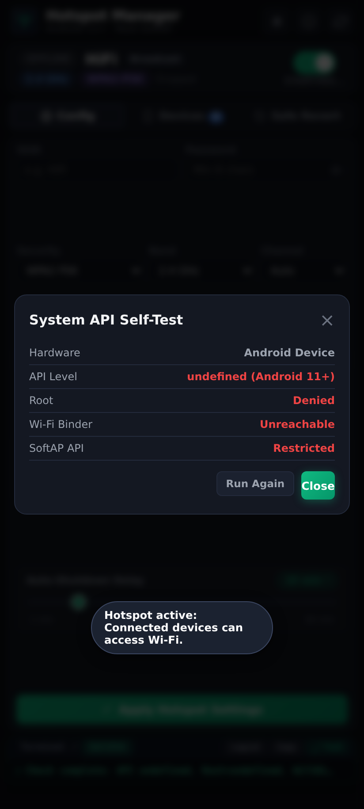

# HMR (Root Hotspot Manager)

[](https://github.com/uniqueselect/HMR/releases)
[-brightgreen?style=flat-square)](https://developer.android.com/about/versions/11)
[](https://github.com/topjohnwu/Magisk)
[-purple?style=flat-square)](https://github.com/uniqueselect/HMR)
[](https://github.com/uniqueselect/HMR/releases/tag/v1.3.3)
[](https://github.com/uniqueselect/HMR)

A powerful, standalone root Android application and Wi-Fi SoftAP controller engineered specifically for **Android 11+ (API 30–36)**. Built for AOSP, Project Treble GSIs, custom ROMs, and OEM vendor implementations (MediaTek, Qualcomm Snapdragon, Samsung Exynos, Google Tensor, and Unisoc).

Developed and maintained by **[uniqueselect](https://github.com/uniqueselect)** & **Anti-Gravity**.

---

> [!TIP]
> **Branch & Release Organization**:
> * **`main` branch (Active Development & Latest Release)**: Hosts the latest production Standalone Root APK (**v1.3.3**). All new features and stable releases land here.
> * **`1.3.3` branch**: Dedicated release branch preserved for version pinning, modular organization, and development friendliness.
> * **[`module` branch](https://github.com/uniqueselect/HMR/tree/module)**: Dedicated branch preserving the legacy flashable Magisk / KernelSU / APatch module source.

---

> [!WARNING]
> ### ⚠️ EXPERIMENTAL TESTING NOTICE & DISCLAIMER OF LIABILITY
> **HMR interacts directly with low-level Android Binder IPC frameworks (`IWifiManager`), network routing tables, and Linux kernel firewall hooks (`iptables`). It is intended for developers, power users, and Android root enthusiasts.**
>
> **DISCLAIMER**: Under no circumstances shall the authors, contributors, or maintainers be held liable for any damages whatsoever—including but not limited to hard bricks, bootloops, partition corruption, data loss, network anomalies, carrier throttling, or hardware malfunctions. **Execute at your own risk. Always maintain an off-device backup before proceeding.**

---

## 📱 Mobile UI & Screenshots Tour

HMR features an adaptive dark **Cyber-Slate** interface optimized for one-handed mobile control, edge-to-edge system bar integration, and real-time diagnostic telemetry.

<p align="center">
  
  
  
</p>
<p align="center">
  <em>01. Master Configuration Dashboard &nbsp;&bull;&nbsp; 02. Connected Devices &amp; Access Control &nbsp;&bull;&nbsp; 03. Safe Factory Revert Engine</em>
</p>

<p align="center">
  
  
</p>
<p align="center">
  <em>04. Low-Level System Diagnostics Suite &nbsp;&bull;&nbsp; 05. Dev Lab &amp; Engine Identity Modal</em>
</p>

---

## 🌟 Modern Architecture: Standalone Root Application

Traditional root hotspot utilities attempt to rewrite raw XML files (such as `/data/misc/wifi/WifiConfigStore.xml`). This approach is brittle across Android updates, risks bootloops if XML schemas change, and requires a full device reboot to take effect.

**HMR operates on a dynamic runtime IPC architecture with a persistent root stream:**

```text
┌────────────────────────────────────────────────────────┐
│            HMR Standalone Root APK (Android)           │
│  - Edge-to-Edge System Bar Tinting & Lifecycle Sync    │
│  - System BroadcastReceiver (WIFI_AP_STATE_CHANGED)    │
│  - Modern Cyber-Slate Dashboard WebUI (Assets)         │
└──────────────────────────┬─────────────────────────────┘
                           │ Persistent Interactive Root Stream (stdin/stdout pipe)
┌──────────────────────────▼─────────────────────────────┐
│        KsuBridge (Single Interactive Root Shell)       │
│  - Zero Superuser toast spam (< 2ms execution)         │
│  - Sentinel delimiter protocol (__HMR_END_OF_CMD__)    │
└──────────────────────────┬─────────────────────────────┘
                           │ executes via app_process (UID 0)
┌──────────────────────────▼─────────────────────────────┐
│          bin/hotspot_helper.jar (Compiled DEX)         │
│  - Acquires android.net.wifi.IWifiManager Binder       │
│  - Direct SoftApConfiguration.Builder reflection       │
│  - Universal Local LAN & Multicast Routing Engine      │
│  - Android Ground-Truth Client Tracker (TetheredClient)│
└──────────────────────────┬─────────────────────────────┘
                           │ Native IPC & Netfilter Hooks
┌──────────────────────────▼─────────────────────────────┐
│          Android Framework (system_server)             │
│        Wi-Fi HAL & hostapd / wificond daemons          │
└────────────────────────────────────────────────────────┘
```

### Key Architectural Pillars:
1. **Dynamic Runtime Configuration (Zero Reboots Needed)**:
   * Changes to SSID, password, security protocol, band, stealth hidden mode, client limits, or shutdown timeouts apply dynamically at runtime via live Binder IPC calls to Android's active `system_server`.
2. **Persistent Root Session (Zero Toast Overhead)**:
   * Uses a persistent Unix pipe to a single `su` shell session in `KsuBridge.java`. Reduces execution latency to under 2ms and permanently eliminates recurring Superuser toast notification popups.
3. **Universal Peer-to-Peer File Sharing Engine**:
   * Automatically bypasses MediaTek and vendor Wi-Fi driver packet filtering (`allmulticast on`), configures multicast routing (`224.0.0.0/4 dev <apIface>`), and permits local subnet `INPUT`, `FORWARD`, and `OUTPUT` traffic so file sharing apps (**LocalSend, KDE Connect, Warpinator, AirDroid, Feem, FTP, HTTP**) connect seamlessly without exposing mobile data.
4. **Safe Ground-Truth Disconnect Verification**:
   * Cross-references active clients against Android's official system diagnostics (`dumpsys tethering` `TetheredClient`s from `ConnectedClientsTracker`, `dumpsys wifi` `SoftApManager`, and physical Layer 2 `iw dev station dump`).
   * When a client disconnects, it is purged immediately upon Wi-Fi deassociation—with **zero destructive ARP cache flushing** (`ip neigh flush` is permanently banished), ensuring active transfers never get dropped.
5. **Authentic Device Name Preservation**:
   * Purged legacy lowercase mutators; client hostnames announced via DHCP Option 12 are displayed verbatim with original casing (e.g. `ASUS-TUF-5077`).
6. **Deterministic Release Keystore**:
   * Signed with a persistent cryptographic keystore (`SHA-256: 97:80:34:99:32...`). All subsequent updates install cleanly over existing versions without package signature conflicts.

---

## ⚡ Core Features

- 📶 **Master Control & Instant Toggle**: Turn Wi-Fi SoftAP on or off with a single tap, with automatic real-time sync with Android Quick Settings and System Settings.
- 🏷️ **SSID & Security Suite**: Configure network SSID, WPA2-PSK, modern WPA3-SAE, WPA3-Transition, or Open networks with instant password reveal.
- 📡 **Dual-Band & Channel Optimization**: Seamlessly switch between 2.4 GHz (Long Range) and 5.0 GHz (High Throughput), with manual channel selection (Ch 1–11 for 2.4 GHz; Ch 36–165 for 5 GHz).
- 👻 **Stealth Mode (Hidden SSID)**: Disable beacon broadcasts to make the hotspot completely invisible to passive network scanners.
- 👥 **Dynamic Client Limiting**: Numeric stepper slider to constrain maximum concurrent connections (1 to 32 clients, or 0 for unlimited).
- ⏱️ **Intelligent Inactivity Timeout**: Configurable auto-shutdown timer (custom presets: 5m, 10m, 15m, 30m, 60m, or disabled) that automatically powers down the hotspot when all devices disconnect.
- 📁 **Universal Peer-to-Peer LAN & File Sharing**:
  - Full out-of-the-box compatibility with **LocalSend, KDE Connect, Warpinator, AirDroid, Feem, FTP, and HTTP**.
  - Multicast driver unfiltering enables mDNS (`224.0.0.251`) and broadcast discovery across MediaTek Helio and GSI devices.
  - Station forwarding (`iptables -I FORWARD`) enables direct peer-to-peer transfers between connected clients (e.g. laptop to tablet).
- 🛡️ **Zero-Flushing Disconnected Device Purge**:
  - Validates candidates against Android's official `TetheredClient` and `SoftApManager` active records.
  - Departed devices drop from the list immediately upon Wi-Fi deauthentication.
  - Idle connected devices (`STALE` state per RFC 4861) remain connected safely without dropped packets.
- 🔤 **Authentic Uppercase Device Naming**: Preserves exact device naming broadcast via DHCP Option 12.
- 🛡️ **Dual-Tier Client Access Control**:
  - **Layer 2 (Data Link)**: Blocks MAC addresses at the SoftAP driver level.
  - **Layer 3/4 (Network)**: Drops client traffic via kernel packet filtering (`iptables -I FORWARD -m mac --mac-source <MAC> -j DROP`).
- 🩺 **Integrated Diagnostic Suite**: Self-testing modal that checks root capabilities, Binder IPC connectivity, Android API level, and vendor Wi-Fi interface bindings.
- 💾 **Factory Backup & Safe Revert Engine**: Automatically snapshots untouched factory Wi-Fi configuration and provides one-click instant safe restoration.

---

## 📦 Project Directory Structure

```text
HMR/ (main branch & 1.3.3 release branch)
├── app/                              # 📱 Standalone Android Root APK (Android Studio Project)
│   ├── build.gradle                  # App Gradle build file (versionCode 133, versionName 1.3.3)
│   ├── proguard-rules.pro            # R8 shrinking & code protection rules
│   └── src/main/
│       ├── AndroidManifest.xml       # App permissions, intents, and launch activity
│       ├── java/com/uniqueselect/hmr/
│       │   ├── MainActivity.java     # Edge-to-edge UI, broadcast receiver & WebView lifecycle
│       │   └── KsuBridge.java        # Persistent interactive root process & IPC bridge
│       ├── res/                      # Vector drawables, adaptive launcher icons, layout, colors
│       └── assets/                   # Bundled assets packaged into the APK
│           ├── bin/
│           │   ├── hotspot-ctl          # Multi-call CLI shell interface
│           │   └── hotspot_helper.jar   # Compiled root DEX helper (UID 0)
│           ├── webroot/                 # Modern responsive Cyber-Slate WebUI dashboard
│           │   ├── index.html           # HTML5 structure with SVG icons & tab navigation
│           │   ├── style.css            # Dark theme styles & responsive mobile layout
│           │   └── app.js               # WebUI state controller, polling & terminal logger
│           └── module.prop              # Internal package metadata
├── src/                              # ☕ Root DEX Helper Backend Java Source
│   └── com/antigravity/hotspot/
│       └── HotspotHelper.java        # Binder reflection, client tracking & LAN routing
├── keystore/                         # 🔑 Persistent Release Signing Keystore
│   └── release.jks                   # Deterministic signing key for seamless in-place updates
├── screenshots/                      # 📸 Mobile UI screenshots (Dashboard, Devices, Revert, Diag)
├── scripts/                          # 🛠️ Build & Automation Scripts
│   └── build_apk.sh                  # Standalone zero-dependency APK builder & signer
├── build.gradle                      # Root Gradle project configuration
├── settings.gradle                   # Android Studio settings (includes ':app')
├── gradle.properties                 # Gradle JVM and build properties
└── README.md                         # Comprehensive project documentation
```

---

## 🚀 Installation & Getting Started

### Option A: Standalone Root APK (Recommended — No Reboot Needed!)
1. Download **`HMR-v1.3.3.apk`** from [Releases](https://github.com/uniqueselect/HMR/releases/tag/v1.3.3).
2. Install the APK normally on your Android device.
3. Open **Hotspot Manager** from your home screen / app launcher.
4. Grant Superuser root access when prompted by Magisk, KernelSU, or APatch.
5. **Ready immediately! Zero reboots required.**

---

### Option B: Magisk / KernelSU / APatch Module (Legacy)
If you prefer a flashable module package managed directly through Magisk or KernelSU:
* Switch to the **[`module` branch](https://github.com/uniqueselect/HMR/tree/module)** to download or build the flashable module ZIP.

---

## 💻 CLI Usage (`hotspot-ctl`)

HMR includes a command-line interface bundled inside the application and accessible via Termux or any root ADB shell:

```bash
# Check hotspot status and active configuration (JSON)
su -c hotspot-ctl status

# List currently connected clients (IP, MAC, Hostname, Interface)
su -c hotspot-ctl clients

# Start the Wi-Fi hotspot
su -c hotspot-ctl start

# Stop the Wi-Fi hotspot
su -c hotspot-ctl stop

# Restore factory stock Wi-Fi settings
su -c hotspot-ctl restore-original

# Run hardware and API diagnostic checks
su -c hotspot-ctl check

# View real-time SoftAP logs from wificond & hostapd
su -c hotspot-ctl logcat
```

---

## 🛠️ Building from Source

You can build HMR either with standard Android Studio / Gradle or using the standalone zero-dependency build script:

### Using the Standalone Build Script:
```bash
# Ensure Android SDK build tools (aapt2, d8, zipalign, apksigner) are available in PATH or /tmp/
bash scripts/build_apk.sh
```
The output APK is generated at `HMR-v1.3.3.apk` and signed with the persistent release keystore.

### Recompiling the Java Root Helper (`HotspotHelper.java`):
```bash
# Compile Java source
javac -cp "$ANDROID_HOME/platforms/android-36/android.jar" -d /tmp/classes src/com/antigravity/hotspot/HotspotHelper.java

# Convert class files to DEX
d8 --lib "$ANDROID_HOME/platforms/android-36/android.jar" --output /tmp/dex $(find /tmp/classes -name "*.class")

# Package into JAR
cd /tmp/dex && jar cvf hotspot_helper.jar classes.dex
cp /tmp/dex/hotspot_helper.jar app/src/main/assets/bin/hotspot_helper.jar
```

---

## ❓ Frequently Asked Questions (FAQ)

### Q1: Why is HMR a standalone APK now instead of requiring a Magisk module flash?
Earlier versions required flashing a Magisk module and rebooting the device just to mount files. Migrating to a standalone Android application (`com.uniqueselect.hmr`) provides the best of both worlds:
* **Zero Reboots**: Download APK, install, grant root, and it is immediately active.
* **Seamless Updates**: Updating HMR is as simple as installing the new APK over the existing one.
* **Universal Compatibility**: Works identically on Magisk, KernelSU, and APatch across all Android 11+ ROMs and GSIs.

### Q2: How does file sharing (LocalSend, KDE Connect, Warpinator) work across the hotspot?
On stock Android and MediaTek GSIs, default firewall chains (`fw_INPUT`, `tetherctrl_FORWARD`) and driver-level packet filters block local station-to-host and station-to-station traffic, and drop multicast frames (`224.0.0.0/4`). HMR's universal LAN engine automatically:
1. Unlocks driver-level multicast on the hotspot interface (`ap0`).
2. Adds a kernel multicast route directing mDNS (`224.0.0.251`) discovery through the hotspot.
3. Permissively allows local subnet input to host ports (e.g. LocalSend HTTP 53317, KDE Connect 1714–1764) and client-to-client station forwarding (`iptables FORWARD`), while keeping cellular data (`rmnet+`) completely isolated and secure.

### Q3: How does disconnect detection work without deleting active connections?
HMR checks Android's official active ground truth:
* Queries `dumpsys tethering` (`TetheredClient` instances maintained by Android's internal `ConnectedClientsTracker`) and `dumpsys wifi` (`SoftApManager`).
* Cross-references physical Layer 2 associations via `iw dev <iface> station dump`.
* When a device disconnects from Wi-Fi, Android immediately drops it from active tethered stations, allowing HMR to purge it instantly—with **zero ARP cache flushing**. Live connected devices that transition to `STALE` state (RFC 4861) maintain uninterrupted socket connections.

### Q4: Why do updates never fail with "App not installed as package appears to be invalid"?
Android strictly forbids installing an APK over an existing installation if the signing certificates differ. HMR is signed with a deterministic release keystore (`keystore/release.jks`, SHA-256: `97:80:34:99:32...`). Every release is cryptographically signed with this persistent certificate, ensuring clean in-place updates.

### Q5: How does HMR eliminate recurring Superuser toast notification popups?
Standard root apps spawn a new `su -c <command>` process for every query, which triggers a Magisk / KernelSU "Superuser Granted" toast every few seconds. HMR implements a persistent root stream in `KsuBridge.java`: it opens a single interactive `su` shell process at startup and communicates via standard I/O streams using sentinel tokens (`__HMR_END_OF_CMD__`). Root access is granted once, execution overhead drops to < 2ms, and zero toast spam is produced.

### Q6: Does HMR contain hardcoded IP addresses or device-specific vendor quirks?
**Zero.** HMR is strictly universal. SoftAP interface names (`ap0`, `softap0`, `swlan0`, `wlan1`), gateway IPs, and subnet masks are dynamically discovered at runtime from kernel routing tables and system network properties.

---

## 📜 License & Credits

- **Authors**: [uniqueselect](https://github.com/uniqueselect) & **Anti-Gravity**
- **Repository**: [https://github.com/uniqueselect/HMR](https://github.com/uniqueselect/HMR)
- **License**: MIT License - Free for community enhancement, testing, and distribution.
